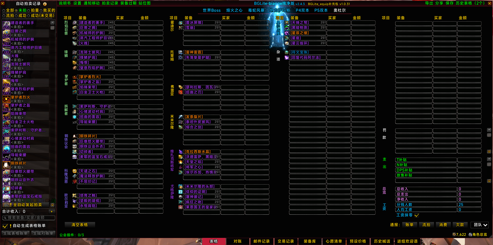

# BGLite_equip

English 丨 [简体中文](docs/README_zhCN.md)

> **Links**
>
> - **CurseForge:** <https://www.curseforge.com/wow/addons/bglite-equip>
> - **Downloads (all releases):** <https://github.com/zlyon/BGLite_equip/releases>
> - **Screenshot:**

---

**BGLite_equip** is a "feature-completion" addon for the BiaoGe auction spreadsheet — it restores, as an **independent addon**, the features that BGLite Pure Edition has trimmed away.

It modifies **not a single BGLite file**; it simply layers on top of it. With this companion installed, BGLite keeps working exactly as before, while you also get a complete auction-spreadsheet feature set — item library and wishlist, preset and psychology prices, trade history and automatic bookkeeping, auto-start auction, character overview, damage-reduction chain and positioning map, item tooltip extensions and more. Nothing left out.

**What it means:** feature completeness is no longer tied to your choice of addon. You don't have to switch addons to get the features, and you don't have to worry that adding a feature addon will destabilise the addon you already use — **keep your existing addon as it is, and you have a complete auction spreadsheet.**

## Why it is needed

**1. BGLite is the official addon.**
It is repackaged and published by the World of Warcraft CN operation team (NetEase / Leihuo). To stay compliant and lightweight, it has trimmed away a large number of features unrelated to basic auctions. Yet many players trust only official addons, or their environment permits official addons only — which is entirely reasonable. This companion addon exists precisely for those players.

**2. But BiaoGeX and the official BGLite cannot coexist.**
Both declare the **same saved-variables table** (`## SavedVariables: BiaoGe`) and occupy the same set of global UI frames and function names — enabling both at once will overwrite each other's data and delete each other's windows. **It is strictly an either/or choice:** enabling BiaoGeX means you must disable BGLite, and vice versa.

**3. So players are forced to choose.**
If you want the official addon, you have to give up the item library, the wishlist, trade history, the character overview, item tooltip extensions and many other things you use every single day.

**4. This companion addon removes that trade-off.**
It **does not modify a single file of BGLite**; instead it restores the features trimmed from the official Pure Edition in the form of an **independent addon**. Your choice now becomes:

> **Keep using the official addon — compliant and safe — while getting the full feature set of BiaoGeX.**

## My personal recommendation

> **The following is my personal opinion. It is not the opinion of the original author MoonForWow, and it does not represent the official team.**

| Your situation | My recommendation |
|---|---|
| **Free to choose your addons** | ⭐ **Use the original author's BiaoGeX** |
| **Playing outside the CN realms** (US / EU / Asia, etc.) | ⭐ **The original BiaoGeX is especially recommended** |
| Trust official addons more / only official addons are permitted | **BGLite + this companion addon** |

**Why I recommend the original BiaoGeX:**

- It is **the original author's own work** — **more native and more complete**. Features and updates take it as the reference; this companion addon only ports and completes it.
- **It even supports World of Warcraft: Forever** (interface `16001`), which **BGLite does not** — so for World of Warcraft: Forever players, the original is the only option.
- Outside the CN realms, the "official addon vs. full feature set" trade-off does not exist at all, so **adding an extra layer is unnecessary**.

**Therefore:** this companion addon is not here to replace BiaoGeX — it gives players who choose the official BGLite a solution with **nothing left out**.

## Dependency (important)

- **BGLite must be installed as well**, and it must be working properly (this addon is merely a patch layer on top of it).
- This addon does not bundle BGLite, nor does it replace or overwrite any of its files; the relationship is "base + patch".
- This addon writes its saved data to `MyUnderpants` (a separate saved-variables table shared with the character-overview addon) and **does not read or write BGLite's `BiaoGe` data**.
- ⚠ **Do not enable it together with BiaoGe / BiaoGeX** (see point 2 above — they will damage each other).

## Supported versions

**Whatever versions BGLite supports, this addon supports** (the detection logic is identical to BGLite's, switching automatically by client interface number):

| Client | Interface | Supported |
|---|---|---|
| Classic Era (Classic / Anniversary / Season of Discovery) | 1.15.x | ✅ |
| The Burning Crusade | 2.5.x | ✅ |
| Wrath of the Lich King | 3.4.x | ✅ |
| Cataclysm | 4.4.x | ✅ |
| Mists of Pandaria | 5.5.x | ✅ |
| Retail | 12.x | ✅ |
| Titan (`Titan Reforged Classic`) | 3.80.x (`38000` / `38001` / `38002`) | ✅ |
| World of Warcraft: Forever (Classic+) | 1.60.x (`16001`) | ❌ |

## What it restores

| Module | Description |
|---|---|
| Item library / Wishlist | Item library window, wishlist, watch & reminders, set and class filters |
| Preset price / Psychology price | Auction preset prices, psychology-price entry button and hotkeys |
| History / Trade records | History table, history summary, automatic trade bookkeeping (including the case of an immediate follow-up trade right after one completes) |
| Auto-start auction | A button at the bottom of the un-auctioned list: automatically starts auctions, front to back, for items that already have a preset price (the right-click menu sets the max number of simultaneous auctions, 4–10, and "only auction items with quantity 1") |
| Channel / Query history | Trade and chat history, records of players you have looked up |
| Group-join greeting | Automatically greets new members when they join the group |
| One-click holiday dungeon | A one-click button on the looking-for-group frame |
| Character overview | Cooldown / badge / gold overview for every character on the account (a separate window, reads and writes `MyUnderpants`) |
| Damage-reduction chain / Positioning map | Receives and displays the mitigation-chain progress bars and the boss positioning map your raid leader sends through the TuanJian assistant addon (TuanJian must be installed as well) |
| Item expiration reminders | "Expired" item hints and filtering |
| Info bar / Drop sources | Info-bar shortcuts, drop-source lookup (AtlasLoot enhancement) |
| Item tooltip extensions | Hovering an item shows the historical price range, preset auction price and psychology price |
| Mount data / MoP currency mapping | Mount source data, Mists of Pandaria currency mapping |

## Installation

1. Download the zip of the latest release from [Releases](https://github.com/zlyon/BGLite_equip/releases) (or from [CurseForge](https://www.curseforge.com/wow/addons/bglite-equip)) and extract it into World of Warcraft's `Interface/AddOns/` folder;
2. Make sure `AddOns/BGLite/` and `AddOns/BGLite_equip/` **both exist**, and **do not** enable `AddOns/BiaoGe/` or `AddOns/BiaoGeX/` at the same time;
3. In game, type `/bgr` (or click the minimap button) to open settings → the "Complementary Features" tab.

## Compliance & safety

- **No privacy exposure:** this addon does not collect, upload or forward any of the player's data, and contains no logic that sends local information outwards. Its contents have been statically reviewed file by file.
- **Fully open, unencrypted, unobfuscated source:** everything is plain-text Lua, reviewable line by line, with no compiled artifacts and no obfuscated code.
- **All addon-channel messages are official, pre-existing content:** every addon-channel message this addon involves (starting an auction, refunding a failed auction, etc.) **reuses BGLite's official auction message formats and protocols as they are**; this addon **creates no new broadcast content and adds no new communication channel**. The auction process itself requires the addon channel, and in that respect this addon behaves exactly like the official BGLite.
- **Does not modify the official addon:** this addon exists independently; it neither rewrites nor replaces any BGLite file, so uninstalling it leaves BGLite as it was.

## Credits

- Original BiaoGe / BiaoGeX author: **MoonForWow**
- BGLite Pure Edition: **World of Warcraft CN operation team (NetEase / Leihuo)**, repackaged
- This addon (BGLite_equip companion): **zlyon**

This addon is an **unofficial** companion, with **no affiliation whatsoever** to the authors and teams listed above. The code it contains that was ported from BiaoGe remains the copyright of the original author. All recommendations in this description are zlyon's personal opinion.

## Features not included

The following features are **not provided at all**:
YY reviews, raid board, world-boss CD broadcast, 集结号 integration, reporting, shopping / store-related.

The reasons differ: either their core mechanism is custom addon-channel communication (YY reviews, raid board, world-boss CD broadcast), or they depend on external addons (集结号, store), or the original author has already disabled them himself (reporting). **This addon follows exactly one principle — it only decides "whether to port this feature":** if yes, any broadcasts inside it are kept exactly as BGLite has them; if no, the whole feature is dropped.

---
